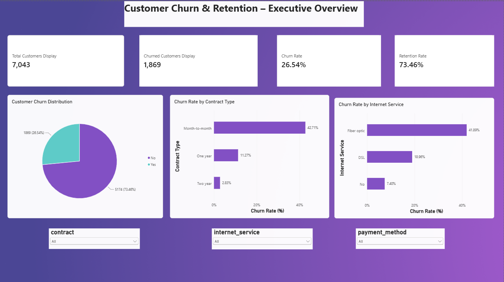
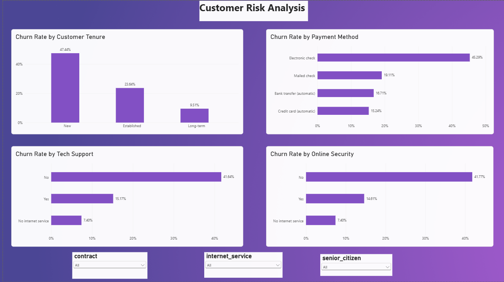
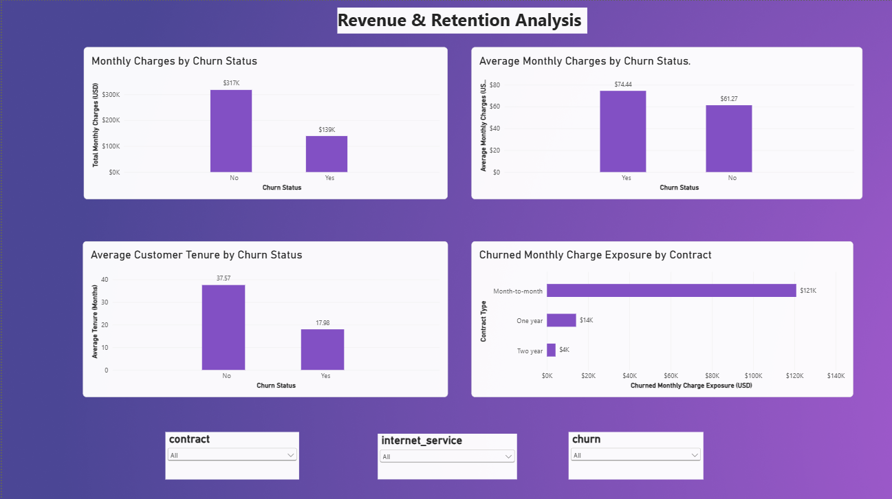

# Customer Churn & Retention Analytics

An end-to-end data analytics project focused on analyzing customer churn, identifying high-risk customer segments, and understanding customer retention and revenue exposure using **PostgreSQL, Python, Pandas, and Power BI**.

## 📌 Project Overview

Customer churn is a major challenge for subscription-based businesses. Understanding why customers leave and identifying segments with higher churn rates can help businesses develop effective customer retention strategies.

This project analyzes the IBM Telco Customer Churn dataset to identify customer behavior patterns, investigate factors associated with churn, and generate actionable business insights through SQL analysis, Python exploratory data analysis, and an interactive Power BI report.

## 🎯 Business Objectives

- Analyze overall customer churn and retention rates.
- Identify customer segments with higher churn rates.
- Understand the relationship between contract types and customer churn.
- Analyze churn patterns across payment methods and internet services.
- Investigate the relationship between customer tenure, monthly charges, and churn.
- Identify opportunities to improve customer retention.

## 🛠️ Tools & Technologies

| Tool | Purpose |
|---|---|
| PostgreSQL | Data storage and SQL-based business analysis |
| Python | Data cleaning and exploratory data analysis |
| Pandas & NumPy | Data manipulation and transformation |
| Matplotlib & Seaborn | Data visualization |
| Power BI | Interactive reporting and dashboards |
| DAX | KPI calculations and analytical measures |
| Git & GitHub | Version control and project management |

## 📂 Dataset

**Dataset:** IBM Telco Customer Churn

**Source:** [Kaggle – Telco Customer Churn Dataset](https://www.kaggle.com/datasets/blastchar/telco-customer-churn)

The dataset contains 7,043 customer records and 21 original attributes, including:

- Customer demographics
- Account information
- Contract details
- Internet and support services
- Monthly and total charges
- Customer churn status

The target variable is `Churn`, which indicates whether a customer has left the company.

## ⚙️ Project Workflow

### 1. Data Cleaning & Preprocessing – Python

- Loaded and inspected the dataset using Pandas.
- Checked missing values, duplicate records, and data types.
- Converted `TotalCharges` into a numeric data type.
- Handled 11 missing `TotalCharges` values associated with customers having zero tenure by replacing them with 0.
- Created additional customer segments based on tenure and monthly charges.
- Prepared the cleaned dataset for further analysis.

### 2. Exploratory Data Analysis – Python

Performed univariate, bivariate, and multivariate analysis to understand customer behavior.

Key analysis areas:

- Customer churn distribution.
- Contract-wise churn analysis.
- Payment method and internet service analysis.
- Tech support and online security analysis.
- Customer tenure and monthly charge distributions.
- Customer segmentation based on tenure and spending.

### 3. SQL Business Analysis – PostgreSQL

Used PostgreSQL to perform structured business analysis, including:

- Overall churn and retention rate calculations.
- Customer segmentation.
- Churn analysis by contract type.
- Payment method analysis.
- Internet service analysis.
- Aggregations and grouped analysis.
- Identifying customer segments with higher churn rates.

### 4. Power BI Reporting

Developed a three-page interactive Power BI report using DAX measures, visualizations, and slicers.

**Page 1 – Executive Overview**

- Total Customers
- Churned Customers
- Churn Rate
- Retention Rate
- Customer Churn Distribution
- Churn Rate by Contract Type
- Churn Rate by Internet Service

**Page 2 – Customer Risk Analysis**

- Churn Rate by Customer Tenure
- Churn Rate by Payment Method
- Churn Rate by Tech Support
- Churn Rate by Online Security

**Page 3 – Revenue & Retention Analysis**

- Monthly Charges by Churn Status
- Average Monthly Charges by Churn Status
- Average Customer Tenure by Churn Status
- Churned Monthly Charge Exposure by Contract

## 📊 Dashboard Screenshots

### 1. Executive Overview



### 2. Customer Risk Analysis



### 3. Revenue & Retention Analysis



## 🔍 Key Business Insights

The analysis revealed several important findings:

**1. Overall Customer Churn**
- Total Customers: 7,043
- Churned Customers: 1,869
- Churn Rate: 26.54%
- Retention Rate: 73.46%

**2. Contract Type**
- Month-to-month customers have the highest churn rate at 42.71%.
- One-year contract customers have a churn rate of 11.27%.
- Two-year contract customers have the lowest churn rate at 2.83%.

**3. Payment Method**
- Electronic check customers have the highest churn rate at 45.29%.
- Customers using automatic bank transfers and credit card payments have comparatively lower churn rates.

**4. Internet Service**
- Fiber optic customers have a churn rate of 41.89%.
- DSL customers have a churn rate of 18.96%.
- Customers without internet service have a churn rate of 7.40%.

**5. Customer Tenure**
- New customers (0–12 months) have a churn rate of approximately 47.44%.
- Established customers have a churn rate of approximately 23.64%.
- Long-term customers have a churn rate of approximately 9.51%.

**6. Monthly Charges**
- Churned customers have an average monthly charge of $74.44.
- Retained customers have an average monthly charge of $61.27.

**7. Customer Retention**
- Retained customers have an average tenure of 37.57 months.
- Churned customers have an average tenure of 17.98 months.

**8. Monthly Charge Exposure**
- Month-to-month contracts account for the largest share of monthly charges associated with churned customers.

## 💡 Business Recommendations

Based on the analysis, the following retention strategies could be considered:

- Develop targeted retention programs for month-to-month customers.
- Improve onboarding and engagement for newly acquired customers.
- Investigate customer dissatisfaction among fiber optic users.
- Review pricing and service value for customers with higher monthly charges.
- Encourage longer-term contracts through suitable retention incentives.
- Investigate service-related issues affecting customers without technical support or online security.

## 📁 Repository Structure

```text
Customer-Churn-Retention-Analytics/
│
├── data/
│   └── telco_customer_churn_final.csv
│
├── notebooks/
│   └── 02_Customer_Churn_EDA.ipynb
│
├── sql/
│   └── schema_and_business_analysis.sql
│
├── powerbi/
│   └── Customer_Churn_Retention_Analytics.pbix
│
├── screenshots/
│   ├── executive_overview.png
│   ├── customer_risk_analysis.png
│   └── revenue_retention.png
│
├── reports/
│   └── business_insights.md
│
├── README.md
├── requirements.txt
└── .gitignore
```

## 🚀 How to Run the Project

### 1. Clone the repository

```bash
git clone https://github.com/kartikN1234/Customer-Churn-Retention-Analytics.git
```

### 2. Install Python dependencies

```bash
pip install -r requirements.txt
```

### 3. Run the Python analysis

Open the Jupyter notebook:

```bash
jupyter notebook
```

Navigate to the `notebooks` folder and run the EDA notebook.

### 4. Run SQL analysis

- Create a database in PostgreSQL.
- Import the cleaned CSV dataset.
- Execute the SQL scripts available in the `sql` folder.

### 5. Open the Power BI report

Open the `.pbix` file from the `powerbi` folder using Power BI Desktop.

## ⚠️ Limitations

- The dataset represents a customer snapshot rather than a time-series record of customer activity.
- Calendar-based churn trends and true monthly cohort retention cannot be calculated from the available data.
- Relationships identified in the analysis are observational and do not establish causation.
- Churned monthly charge exposure represents the sum of monthly charges associated with churned customers, not verified realized revenue loss.

## 👨‍💻 Author

**Kartik Nalawade**

- GitHub: [kartikN1234](https://github.com/kartikN1234)
- LinkedIn: [Kartik Nalawade](https://www.linkedin.com/in/kartik-nalawade-3a663625a/)
---

**If you found this project useful, consider giving the repository a ⭐.**